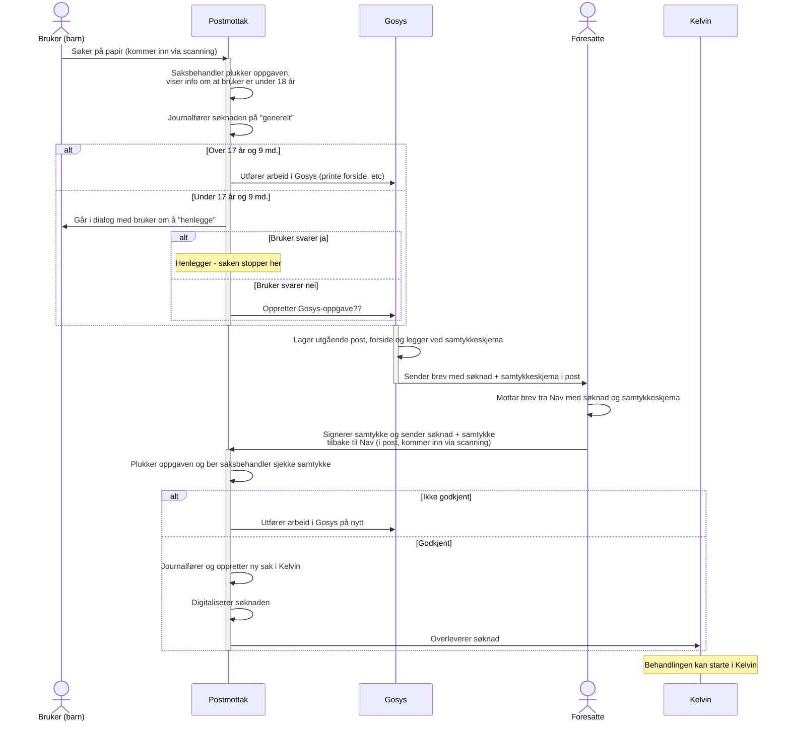

# Håndtere søkere under 18 år

Se [Mural](https://app.mural.co/t/navdesign3580/m/navdesign3580/1786084434143/a6a42df894c66558e8688be6f0de1635d7f46b59). Noe på [Confluence her](https://confluence.adeo.no/spaces/PAAP/pages/772223163/%C2%A7+11-4+Alder+%E2%80%93+bruker+over+67+eller+under+18).

## Sekvensdiagram

