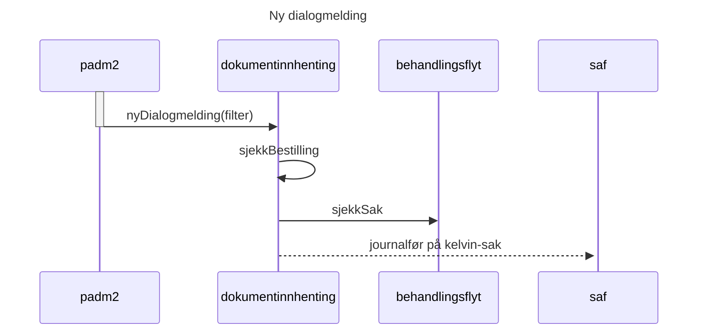
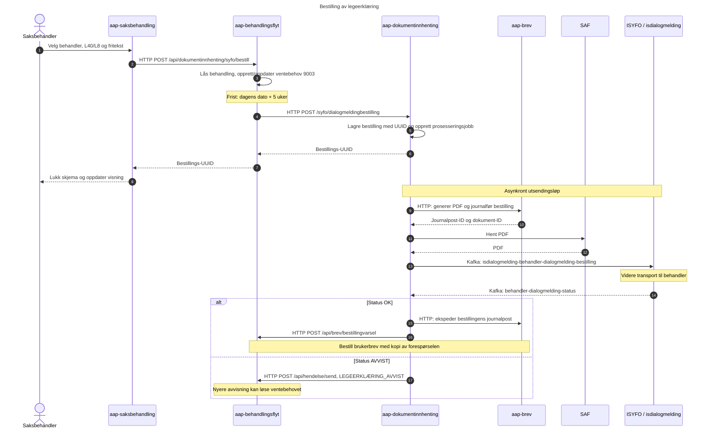

# Teknisk beskrivelse
[Github](https://github.com/navikt/aap-dokumentinnhenting) | [Swagger](https://aap-dokumentinnhenting.intern.dev.nav.no/swagger-ui/index.html) | [Grafana](https://grafana.nav.cloud.nais.io/goto/jcvl7ZwNg?orgId=1)

## Flyter
Dokumentinnhenting er ansvarlig for 4 deler:
* Bestilling av dialogmelding til behandler
* Mottak av dialogmeldinger
* Dokumentsøk
* Automatisk påminnelse

### Dialogmelding
Innkommende legeerklæringer blir journalført på tema AAP i [pale-2-sak](https://github.com/navikt/pale-2-sak), og blir dermed automatisk videresendt til 
`behandlingsflyt` via `postmottak`. Men på grunn av at leger teknisk sett kan svare på en bestilling ved å sende inn
legeerklæring som vedlegg til en ny dialogmelding må vi lytte på Kafka-topic `teamsykefravr.dialogmelding` som [padm2](https://github.com/navikt/padm2)
produserer meldinger på.

Det er ingen garanti for at dialogmeldingen vil være relevant og vi blir nødt til å ta noen forhåndsregler.
Følgende kriterier må oppfylles for at vi vil journaleføre dialogmeldingen på AAP Kelvin-sak:
- Det må finnes en åpen sak for bruker
- Dialogmeldingen må være svar på en forespørsel fra saksbehandler

### Bestilling av legeerklæring
Bestilling av legeerklæring skjer i Kelvin, fra høyremeny i en behandling.
1. Saksbehandling slår opp behandler via dokumentinnhenting, som videre henter informasjon fra isdialogmelding (ISYFO), fastlege eller søk.
2. Ved bestilling settes saken på vent i behandlingsflyt.
3. Bestilling går videre til dokumentinnhenting og lagrer bestillingen.
4. Dokumentinnhenting journalfører via Brev.
5. Dokumentinnhenting sending bestilling til isdialogmelding ved å produsere melding på Kafka-topic `teamsykefravr.isdialogmelding-behandler-dialogmelding-bestilling`, som videre sender til NHN og deretter EPJ.
6. Dokumentinnhenting konsumerer Kafka-topic `teamsykefravr.behandler-dialogmelding-status` (produsent er isdialogmelding) og oppdaterer status på bestilt dialogmelding (BESTILT, SENDT, OK, AVVIST)
6. Dokumentinnhenting eksponerer et endepunkt `/status/{saksnummer}` som returnerer status på bestilte legeerklæringer.

### DokumentSøk
Ved behandling av sak, 

### Automatisk påminnelse
Det sendes automatisk påminnelse til behandler for alle bestillinger som ikke er besvart innen 22 dager etter bestillingsdatoen. Det kjøres en jobb kl. 08.00 hver morgen som sender ut påminnelsene. Obs: Vi begynte å sende ut automatiske påminnelser for bestillinger opprettet den 29. september 2026. Bestillinger fra tidligere enn det vil ikke få sendt automatisk påminnelse. Jobben gjør følgende:
1. Utleder hvilke(n) dato(er) vi skal sende påminnelse for i dag. Dokumentinnhenting har en tabell som lagrer ned hvilke datoer vi allerede har kjørt for. Datoer vi skal kjøre for i dag er intervallet [sist kjørt dato + 1, dagens dato - 22], som nesten alltid vil være 1 dag.
2. Spør behandlingsflyt om hvilke behandlinger som er kandidater for påminnelse. En kandidat for påminnelse er en behandling med status UTREDES, der avklaringsbehovet BESTILL_LEGEERKLÆRING ble opprettet (eller fikk en ny endring med status opprettet) for 22 dager siden, og der vurderingsbehov MOTATT_LEGEERKLÆRING eller MOTTATT_DIALOGMELDING _ikke_ er lagt på behandlingen de siste 22 dagene.
3. For listen med behandlingsreferanser, hent ut L40-bestillinger med matchende behandlingsreferanse og som ble opprettet på datoen vi sender påminnelse for. Filtrer bort bestillinger der det allerede er sendt en påminnelse.
4. Send påminnelse for alle bestillinger funnet i forrige steg.
5. Lagre ned at vi har kjørt for gitt dato.
Fordi vi lagrer datoer kjørt, skal jobben være trygg å rekjøre, og dersom man avbryter en jobb blir det fortsatt sendt påminnelser dagen etter for dagen man "gikk glipp av".
